<div align="center">

# lafei.

**把知识收好，把行动理清。**

**AI 时代的原生 AI 笔记与任务软件。**

一个把「知识笔记」「任务管理」和「内置 AI」放在同一张纸上的本地优先应用。
桌面端用 Tauri 2，手机端是同一套代码的响应式 PWA。

`React 19` · `TypeScript` · `Tauri 2` · `IndexedDB` · `iCloud Drive 文件夹` · `OpenAI-compatible AI` · `MIT`

[](https://github.com/tangf-ai/lafei/actions/workflows/ci.yml)
[](LICENSE)
[](https://github.com/tangf-ai/lafei/releases)

[下载](#下载) · [功能](#功能) · [快速开始](#快速开始) · [iCloud 目录同步](#用-icloud-drive-当同步盘) · [配置-ai](#配置-ai) · [数据与隐私](#数据与隐私) · [参与贡献](#参与贡献) · [路线图](#路线图)

</div>

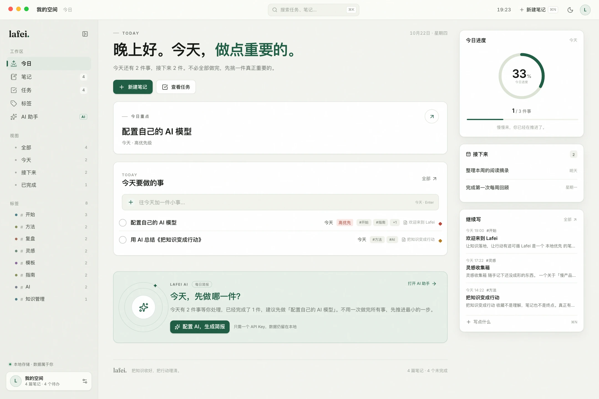

| 笔记与阅读 | AI 助手 |
| --- | --- |
| 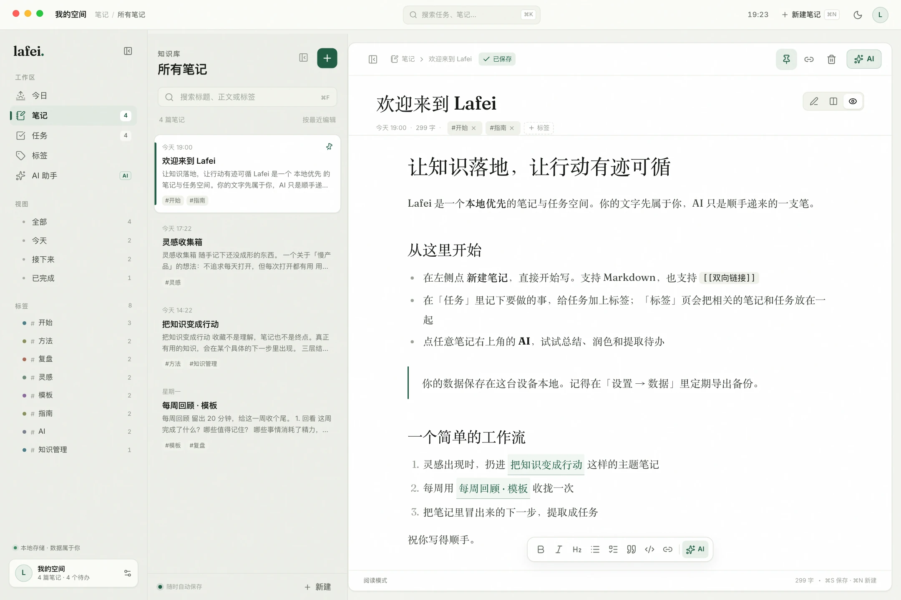 | 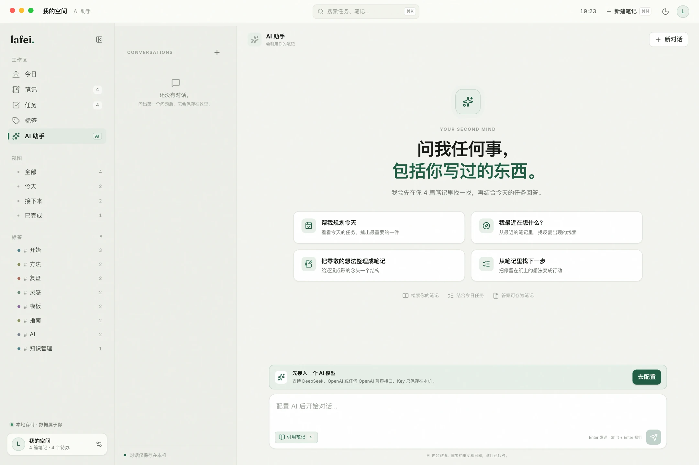 |

| 手机 · 今日 | 手机 · 笔记 |
| --- | --- |
| 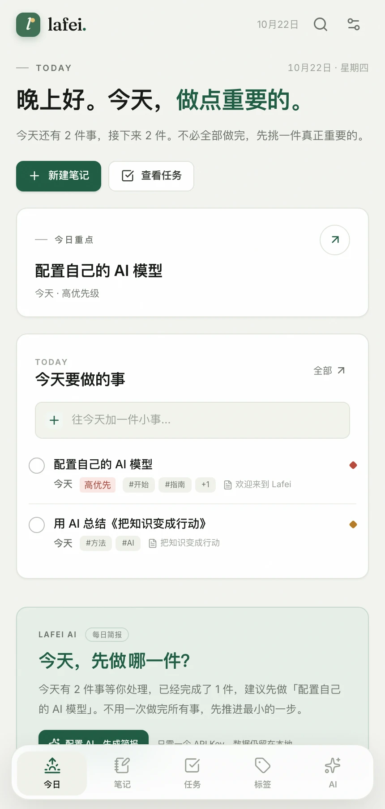 | 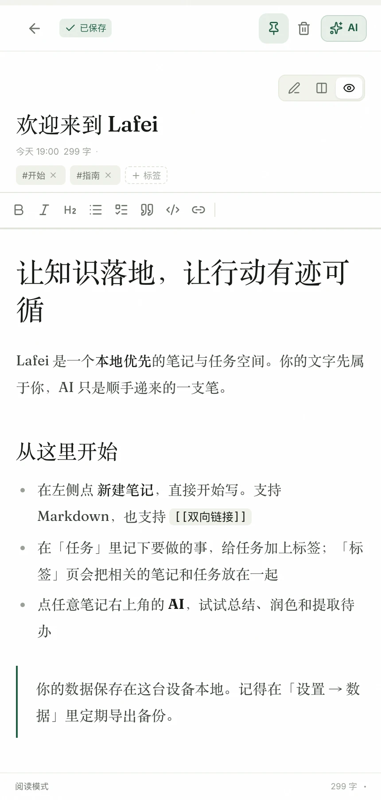 |

> **Lafei（拉斐）** 是当前的工作名，品牌名、图标和产品文案都集中在少量文件里，改名不需要动业务逻辑。

## 下载

| 平台 | 版本 | 说明 |
| --- | --- | --- |
| macOS（Apple Silicon） | [v0.19.1](https://github.com/tangf-ai/lafei/releases/latest) | `Lafei-0.19.1-macOS-arm64.dmg`，ad-hoc 签名、未公证；首次打开如被拦截，右键应用选「打开」 |
| Web / PWA | 源码构建 | `pnpm build` 后把 `dist/` 部署到任意静态托管 |
| Windows / Linux | 源码构建 | Tauri 2 支持，暂未提供预编译包 |

> 安装包不进入 Git 仓库，统一通过 [GitHub Releases](https://github.com/tangf-ai/lafei/releases) 分发。

## 为什么是 Lafei

大多数笔记工具停在「记下来」，大多数待办工具停在「列出来」。Lafei 想做的是中间那一步：让一条知识、一个念头，自然地变成下一步行动；再让 AI 在这个过程里帮你读、帮你找、帮你写，而不是在另一个聊天窗口里从零开始。

它不要求注册账号，也没有 Lafei 服务器。你可以只用本机存储，也可以把数据文件夹放进 iCloud Drive，让 iCloud 负责跨设备同步。AI 用你自己的 API Key，直连你选择的服务商。

## 功能

### 知识笔记

- Markdown 编辑器：标题、列表、待办、引用、代码块、表格
- **Typora 式即时预览**：单击就能落笔，没有「切换到编辑模式」这一步。光标所在的段落会露出 `#` / `-` / `>` 这类块级标记；光标进入某段加粗、链接或代码时，才露出那一段的 Markdown 源码——其余内容始终是排版好的样子。编辑器没有焦点时，整篇按渲染结果显示
- **写的时候就是读的样子**：粗体 / 斜体 / 删除线 / 行内代码、链接、`[[双向链接]]`、图片、分隔线、待办复选框、引用、代码块与 GFM 表格都在正文里即时渲染；表格点一下回到源码，勾选框点一下直接切换
- **大纲面板**：按标题层级列出全文，点击跳转；编辑时跟随光标高亮，阅读时跟随滚动位置高亮
- **聚焦模式 / 打字机模式**：只突出当前段落，或让光标始终停在视野中央，适合长文写作
- **顺手好记的快捷键**：`⌘ /` 切源码、`⌘ 1`–`⌘ 6` 设标题级别、`⌘ B` / `⌘ I` / `⌘ K` 加粗斜体链接，Enter 自动延续列表与引用
- **宽度可调**：正文栏宽度可以左右拖动，分栏模式的分隔线同样可拖；双击恢复默认并记住选择
- 即时预览 / 源码 / 分栏 / 阅读四种模式，500ms 自动保存
- `[[双向链接]]`：输入不存在的标题，⌘ 点击即可创建新笔记；编辑时自动显示反向链接
- 标签、置顶、全文搜索（标题 / 正文 / 标签，本地即时搜索）
- 实时字数、光标行列、更新时间、保存状态一目了然
- 桌面端侧栏和笔记列表可分别收起：侧栏变成图标栏，笔记列表收起后正文占满；默认展开并记住选择

| 即时预览：当前行源码、其余行排版 | 源码模式 | 大纲面板 |
| --- | --- | --- |
| 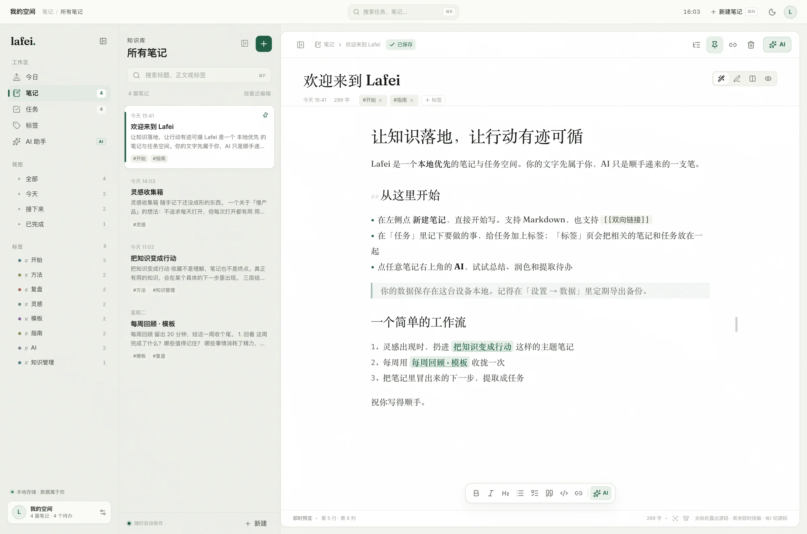 | 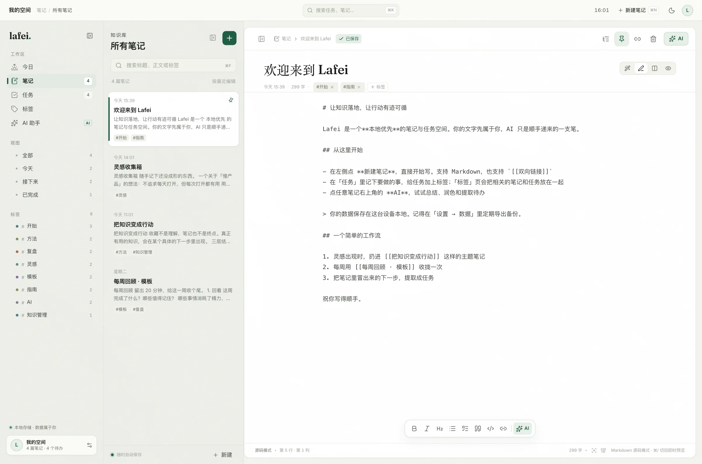 | 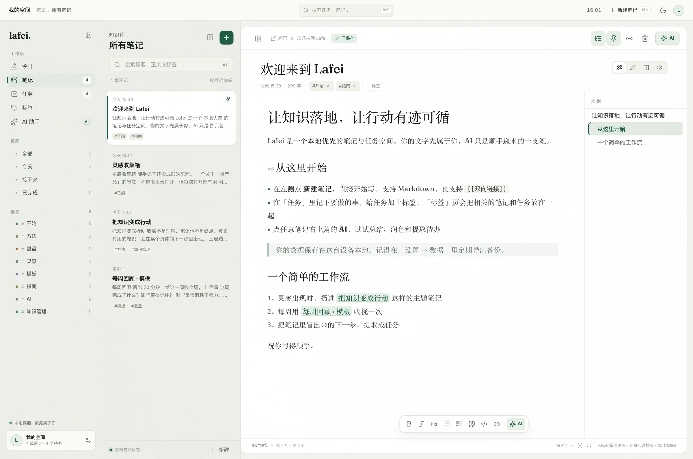 |

| 阅读模式 | 深色主题 | 分栏预览 |
| --- | --- | --- |
| 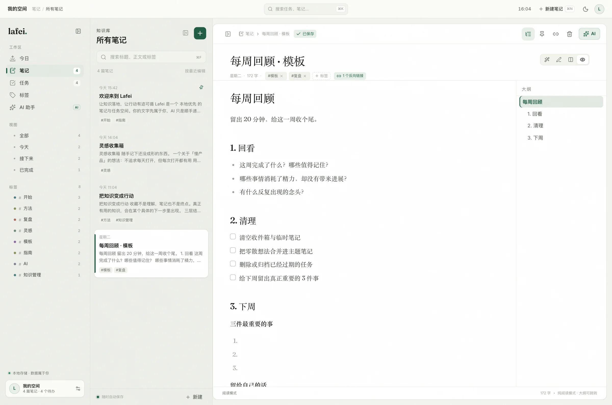 | 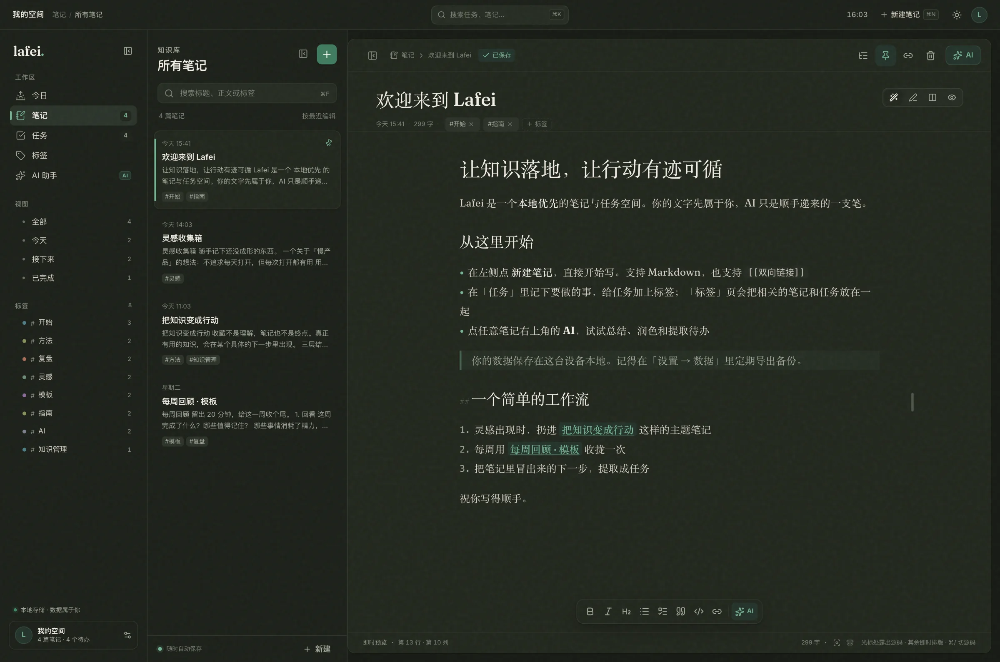 | 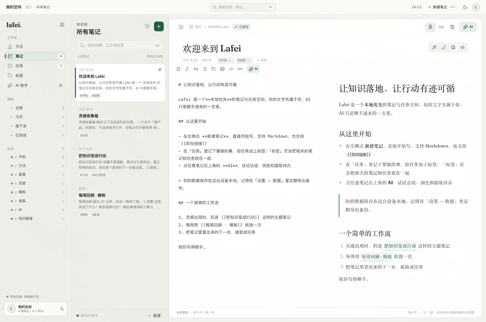 |

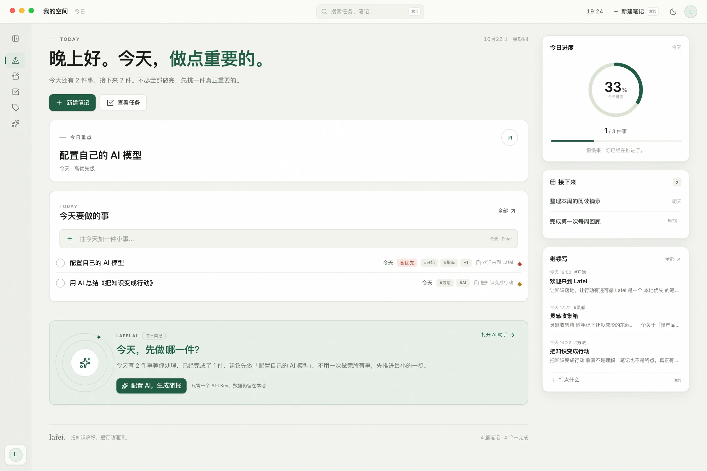

### 任务管理

- 默认是**四象限矩阵**：按「重要 × 紧急」分成四格（纵轴重要向上、横轴紧急向右，所以重要紧急在右上角）
- 矩阵总览是**通栏任务行**：一行一件任务（优先级点 + 标题 + 右侧「星期五 · 剩余 4 天 · #标签」），标题拿满整格宽度；悬停看完整标题，点任务直接打开详情，拖一行到别的格子就能换象限
- 单格最多铺 8 行，更多时收口成「还有 N 件 ›」；矩阵会按内容长高，窗口矮时整页滚一点，任务不会被藏起来
- 没有手动归类的任务按「截止日期 + 优先级」自动落位：已逾期或 7 天内到期 → 紧急列，优先级不是「低」→ 重要行；在任务详情里也能直接改象限
- 矩阵底部是本周节奏 / 进度 / 标签 / AI 分诊的概览带；「AI 分诊」会把一句分诊请求带进 AI 助手输入框
- 也可以切回**列表视图**，按「逾期 / 今天 / 每一天的截止日期 / 无日期」分组
- 今天 / 接下来 / 已完成等视图可快速切换；「接下来」同时包含已排期任务和无截止日期的「待安排」任务
- 截止日期、优先级、标签、备注、关联笔记；支持今天、明天、三天后、自定义日期和无日期
- 下钻后的任务行和列表视图一样可以勾选、打开详情、加标签
- 任务标签可以在添加任务时直接加，也可以在任务详情里增删；任务行会显示标签，点一下就能看到同一标签下的笔记和任务
- 逾期高亮、今日进度；侧边栏显示全部未完成任务数，有逾期时高亮
- 在任务详情里直接跳回来源笔记；删除笔记时任务会保留
- 今日页一键快速添加，并把未来的截止任务单独列出来；右上角显示“今日重点 / 下一件”
- 每条截止任务直接显示「剩余 N 天」，日期分组也标注剩余天数；今天 / 逾期有独立标签
- 月历视图：按日期铺开任务分布，支持切换月份、回到今天、点选某天查看当日任务

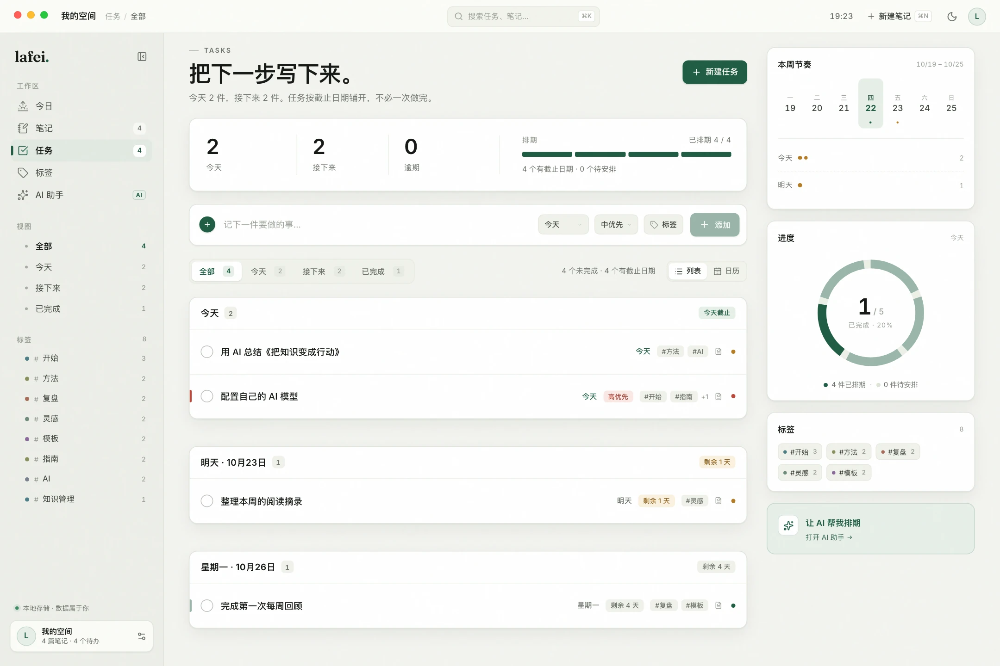

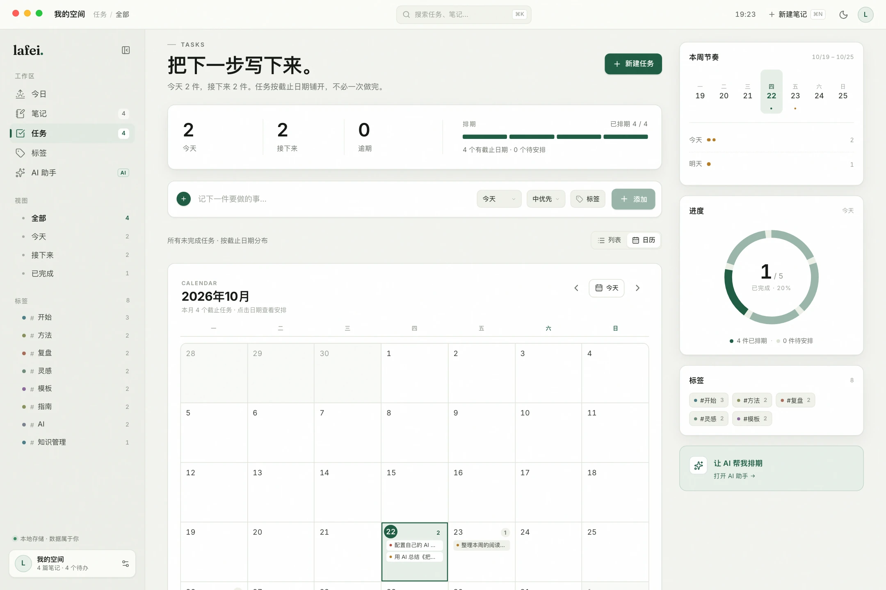

### 标签：把笔记和任务串起来

- 笔记和任务共用同一套标签；一个标签可以同时挂在多篇笔记和多个任务上
- 侧栏标签统计与「标签」页会合并两边的内容，点进一个标签就能同时看到**待办任务 / 已完成任务 / 相关笔记**
- 标签页支持直接新建带此标签的笔记或任务；命令面板输入 `#标签` 也能直达
- 从 Logseq 导入时，任务标题里的 `#标签` 会自动转成 Lafei 任务标签
- 任务标签会随任务一起写入文件夹存储与 JSON 备份；旧任务和旧备份缺少标签时会自动补成空数组

### 内置 AI（不是外挂聊天窗）

- **笔记 AI**：总结当前笔记、提取可执行待办、接着写、起标题、针对选中段落提问
- **AI 助手**：对话会自动检索相关笔记，并把结果标注为可点击的来源；同时了解你当前的未完成任务
- **快速对话浮窗**：不用离开当前页面就能追问——点右下角的绿色悬浮按钮、按 `⌘ J`，或在命令面板搜「快速对话」；浮窗和完整助手页共享同一个对话与同一段流式输出，收起浮窗后生成继续，手机端是从底部弹出的面板
- 提取出的待办可以直接勾选后批量加入任务清单，保留来源笔记
- 回答可以一键存为笔记、复制、追加回原文
- 流式输出、可中止；对话与消息保存在本地

### 智能体访问（MCP）

- 在设置 → 智能体访问中开启后，Lafei 会把笔记和任务导出成一份只读快照
- 快照包含笔记 Markdown、任务 JSONL、标签索引和给智能体的 `AGENTS.md`，不包含 AI 对话和 API Key
- 桌面版随应用打包 `lafei-mcp`（stdio），Codex、Pi 等支持 MCP 的智能体可以直接读取
- 提供 `notes_search`、`notes_get`、`tasks_list`、`tasks_get`、`tags_list` 五个只读工具
- 详细配置与数据契约见 [docs/agent-access.md](docs/agent-access.md)

### 数据仓库 / 文件夹存储

- 一个文件夹就是一个数据仓库：Lafei 会把笔记、任务、AI 对话写成普通文件；任务带着标题、备注、截止日期、优先级、标签、手动象限和完成状态一起同步，笔记带着正文、标签与置顶状态
- 可以保留多个数据目录（工作 / 个人 / 项目），在设置里快速切换；旧仓库不会被删除
- 选择 iCloud Drive 里的目录，就用 iCloud 做免费的跨 Mac 同步，不需要账号或后端
- 每次编辑自动落盘；重新打开或切回应用时，会与目录双向合并
- 可以设定时同步间隔（关闭 / 5 / 15 / 30 分钟 / 1 / 3 小时），到点自动完整合并一次，并显示下次同步时间；同步失败会在 5 分钟内重试，休眠唤醒后会补做
- 关闭定时同步后，编辑仍会实时落盘，打开应用、远程有变化时与「立即同步」也会照常合并
- 新设备接入已有目录时，可以选择「合并两边」或「以文件夹为准」，避免初始示例数据污染已有内容
- 删除会写入 tombstone（删除记录），不会在另一台设备上“复活”
- 冲突按 `updatedAt` 保留较新的版本；iCloud 自己的冲突副本不会破坏当前数据
- 切换数据仓库前会先同步当前仓库；同步失败会取消切换，避免丢数据

### 跨端

| 端 | 当前形态 | 使用方式 |
| --- | --- | --- |
| macOS / Windows 桌面 | Tauri 2 原生窗口 | `pnpm desktop:dev` 或安装构建产物；支持数据仓库 / 文件夹存储 |
| iPhone / Android | 响应式 PWA | 浏览器打开后「添加到主屏幕」；暂不能直读 iCloud 目录 |
| 平板 / 其他设备 | 响应式 Web | 部署静态 `dist/` 即可 |

桌面版是完整原生壳（系统窗口、原生保存对话框、外链用系统浏览器打开）；手机端不依赖 App Store，安装后可以离线打开。

> 数据默认保存在本机 IndexedDB；桌面版可选把数据实时镜像到任意文件夹。手机 PWA 无法访问 iCloud Drive 目录，目前通过备份迁移，原生 iPhone 版会直接读取同一个 iCloud 文件夹。

### 从 Logseq 迁移

- 设置 → 数据与备份 → 从 Logseq 导入，选择 Logseq graph 根目录
- 读取 `pages/` 与 `journals/`，导入 `TODO`、`DOING`、`NOW`、`LATER`、`WAITING` 状态
- 保留 A/B/C 优先级、`SCHEDULED` / `DEADLINE` 日期，以及子块里的「截止 10-23」这类日期
- 任务描述会保存来源页面和文件位置；不会修改 Logseq graph
- 自动跳过 `DONE` / `CANCELED`、备份目录和重复任务；只新增，不覆盖现有数据
- 目前需要桌面版访问本地文件夹

### 主题

- 除浅色、深色、跟随系统外，新增三套完整主题：
  - **晴日**：暖亮、有活力，适合想让一天轻快起来的时候
  - **薄荷**：低对比的护眼绿，长时间阅读更柔和
  - **海盐**：清透的蓝灰色，安静、放松
- 主题会应用到背景、卡片、文字、强调色和状态色，不只是换壁纸
- 选择即时生效，并保存在本机

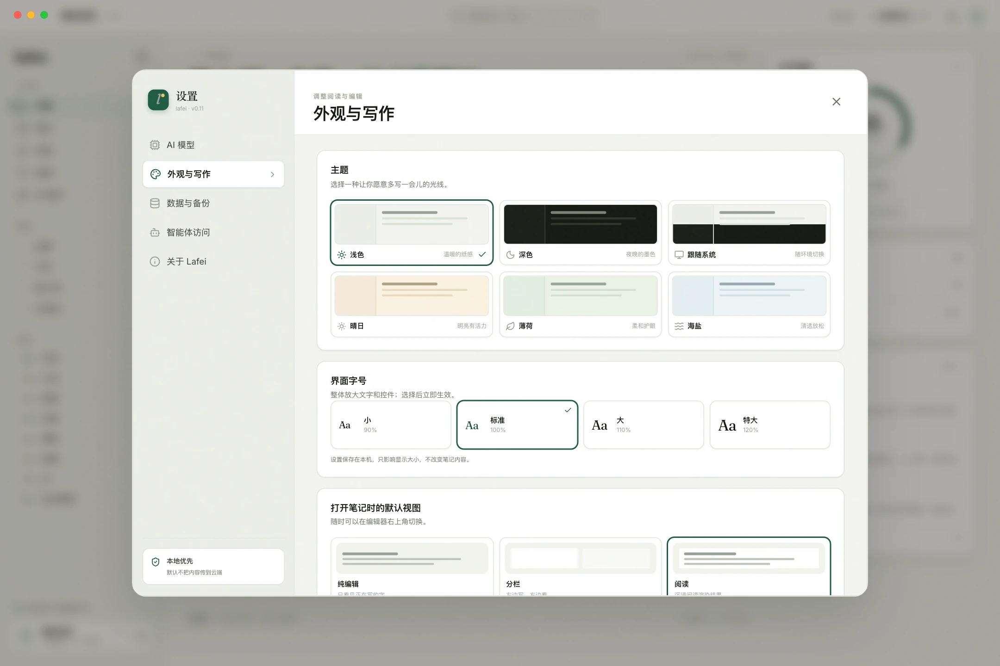

### 可读性

- 设置 → 外观与写作 → 界面字号，提供「小 / 标准 / 大 / 特大」四档（90%–120%）
- 选择后立即生效，并保存在本机；桌面端使用系统级页面缩放，Web/PWA 使用样式缩放
- 大字号下移动端筛选栏保持单行并可横向滑动，不会被挤成两行


## 快速开始

### 环境

- Node.js **22+**
- pnpm **11+**
- 桌面构建额外需要 Rust（stable）和平台工具链；macOS 需要 Xcode Command Line Tools

### Web / PWA 开发

```bash
pnpm install
pnpm dev            # http://127.0.0.1:1420
pnpm build          # 产出 dist/
pnpm preview        # 预览生产构建
```

### 桌面开发与构建

```bash
pnpm desktop:dev     # Tauri 开发窗口 + Vite HMR
pnpm desktop:build   # 生成 .app / .dmg（macOS）或对应平台安装包
```

macOS 构建产物：

```text
Lafei-0.19.1-macOS-arm64.dmg                                      # 可直接分发的安装包
src-tauri/target/release/bundle/macos/Lafei.app                  # 未打包的应用
src-tauri/target/release/bundle/dmg/Lafei_0.19.1_aarch64.dmg      # Tauri 原始产物
```

> 构建产物（`.app` / `.dmg`）不进入 Git，正式版本请通过 GitHub Releases 分发。当前本地产物是 Apple Silicon（arm64）版本，使用 ad-hoc 签名，未做 Apple 公证；若系统提示无法验证，右键应用选择「打开」，或在终端执行：

```bash
xattr -dr com.apple.quarantine /Applications/Lafei.app
```

### 不想配 AI，也想看 AI 流程？

仓库内置了一个 OpenAI 兼容的本地 mock 服务，专门用来验证流式输出、任务提取和引用来源：

```bash
pnpm mock:ai
```

然后在「设置 → AI 模型」选择「自定义 / 本地」：

- Base URL：`http://127.0.0.1:4319/v1`
- 模型：`mock`
- API Key：留空

> 仅用于开发演示，不会产生真实模型能力。

## 用 iCloud Drive 当同步盘

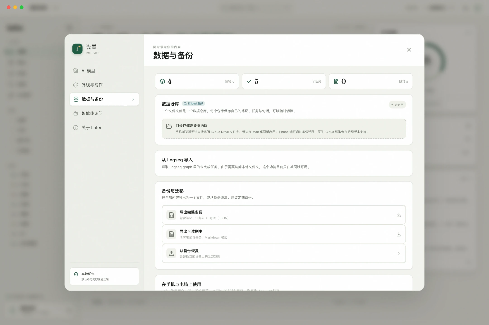

### 第一次启用

1. 打开 **设置 → 数据与备份 → 数据仓库**。
2. 点击「选择文件夹」，在系统文件选择器里选 iCloud Drive 中的位置。建议在 iCloud Drive 里新建 `Lafei` 文件夹；如果选的是父目录，Lafei 会在其中创建 `Lafei/`。
3. 若文件夹是空的，当前数据会写入目录；若已经有 Lafei 数据，会出现选择：
   - **合并两边**：保留本机与目录的所有内容，按更新时间去重
   - **以文件夹为准**：用目录内容替换本机数据；适合第二台 Mac 或新设备接入已有数据

### 切换数据仓库

1. 打开 **设置 → 数据与备份 → 数据仓库**。
2. 点「切换 / 新建」，选择另一个文件夹。
3. 如果目标目录已有 Lafei 数据，本机会载入该仓库；如果是空目录，会创建一个空白仓库。
4. 切换前会先同步当前仓库；旧仓库会保留在「最近的数据目录」里，随时可以切回。
5. 切换完成后应用会重新载入，MCP / 智能体快照也会跟随当前仓库更新。

### 多台 Mac 之间

1. 第二台 Mac 安装 Lafei，打开同样的「数据仓库」并选择同一个 iCloud Drive 目录。
2. 选择「以文件夹为准」接入已有内容（或选择合并）。
3. 之后每次编辑会自动写入文件，iCloud 同步文件；应用重新打开时会自动合并。
4. 应用开着时会每 30 秒检查一次目录的 `manifest.json`，有变化就拉取；也可以随时点「立即同步」。
5. 在「数据仓库」里还能设定时同步：默认每 30 分钟完整双向合并一次，可选 5 分钟到 3 小时，或关闭。行内会显示下一次同步时间；同步失败会在 5 分钟内重试，休眠唤醒后会补做。关闭定时同步后，编辑落盘、打开应用、远程有变化时与「立即同步」仍然照常工作。

### 文件格式

```text
Lafei/
├── manifest.json      同步信息（设备名、更新时间、数量）
├── tombstones.json    删除记录
├── notes/
│   └── <id>.md        YAML 元数据 + Markdown 正文
├── tasks/
│   └── <id>.json
└── chats/
    └── <id>.json      对话 + 消息
```

笔记文件可以直接在 iCloud Drive 或任何文本编辑器里查看。**请优先在 Lafei 内编辑**：手动修改 YAML 元数据可能让文件无法解析；只改正文时，应用不会实时感知。`notes/*.md` 的正文可以直接拿去做别的 Markdown 工具迁移。

### 冲突与边界

- 同步是**文件级**的：同一篇笔记在两个设备同时修改时，更新时间较新的版本获胜，没有逐行合并。
- iCloud 有时候会生成冲突副本；Lafei 会按文件里的 `updatedAt` 选择较新的版本，不主动删除冲突文件。重要内容建议定期导出完整备份。
- 目录存储只支持**桌面版**。手机 PWA 受浏览器沙箱限制，不能直接访问 iCloud Drive；在手机上目前使用备份导入，原生 iOS / Android 壳是下一阶段。
- iCloud 同步由 Apple 负责，存在延迟；不要把“两个设备同时改同一篇笔记”当成协作功能。
- 请通过 Lafei 删除笔记/任务。直接在 Finder 删除文件不会留下 tombstone，下次同步可能被本机数据恢复；如果要删除整个目录，请先在应用内「断开」数据仓库。

## 配置 AI

在应用内打开 **设置 → AI 模型**，填入服务商信息即可。修改会自动保存，点击「测试连接」确认可用。

| 服务商 | Base URL | 模型示例 | 备注 |
| --- | --- | --- | --- |
| DeepSeek | `https://api.deepseek.com/v1` | `deepseek-chat` | 默认选项，国内直连 |
| OpenAI | `https://api.openai.com/v1` | `gpt-4o-mini` | 需要可访问 OpenAI |
| LM Studio | `http://127.0.0.1:1234/v1` | 已加载的模型名 | Key 可留空 |
| Ollama | `http://127.0.0.1:11434/v1` | `qwen2.5:7b` 等 | Key 可留空 |
| 其他 | 任何 OpenAI 兼容 `/v1` 接口 | 服务商的模型 ID | 会自动补全 `/chat/completions` |

- Base URL 以 `/v1` 结尾时会自动补 `/chat/completions`；也可以直接填完整端点。
- 本地接口的 API Key 可以留空。
- 桌面版通过 Tauri 的原生 HTTP/SSE 通道请求 AI 服务，**不受 WebView CORS 限制**，局域网 HTTP 网关也能使用；网页 / PWA 版仍由浏览器直接请求，接口需要允许跨域。
- AI 请求不经过 Lafei 中转。某些公司网络或代理会拦截局域网请求，必要时检查系统代理和本地网络权限。
- **API Key 保存在本机应用存储（localStorage）中，未做系统钥匙串加密。** 这是当前版本的已知限制，请不要在共享设备的浏览器里保存生产 Key。
- 如果连接自定义网关时报“连接不上”，先看「测试连接」返回的是网络错误还是 HTTP 状态：
  - `401 / 403`：Key 或权限问题；
  - `404`：Base URL 或模型名问题；
  - 浏览器 / PWA 下出现网络错误：多半是接口未允许 CORS；桌面版已使用原生网络通道，不受此限制。

## 数据与隐私

- 默认情况下，笔记、任务、对话保存在本机 **IndexedDB**（数据库名 `lafei`），不需要注册。
- 启用桌面版「数据仓库」后，数据还会实时写入你选择的目录。Lafei 不运营中转服务器；如果你把目录放在 iCloud Drive，内容会由 Apple 的 iCloud 按你的设置同步。
- 不采集埋点。网络请求只有：你自己的 AI 请求、你主动打开的外部链接，以及（可选）iCloud 自身的文件同步。
- 设置项（主题、编辑模式、AI 配置、文件夹路径）保存在 `localStorage`。
- 文件夹中的数据格式见[文件格式](#文件格式)，删除记录会写在 `tombstones.json`。
- 备份：
  - 「设置 → 数据与备份 → 导出完整备份」：笔记、任务、对话与删除记录的 JSON
  - 「导出可读副本」：Markdown，方便迁移到其他笔记软件
  - 桌面端使用原生保存对话框写入文件；Web/PWA 使用浏览器下载
  - 导入备份会**替换**当前设备上的全部数据；如果已连接文件夹，也会覆盖文件夹中的 Lafei 数据，建议先导出当前备份
- 删除笔记会同时解除关联任务与笔记的链接，但不会删除任务。启用数据仓库时，删除会同步到其他设备。

## 跨端部署

### 手机安装 PWA

1. 将 `dist/` 部署到任意支持 HTTPS 的静态托管（Vercel、Netlify、Cloudflare Pages、自己的服务器均可）。
2. 手机浏览器打开地址。
3. iOS Safari：分享 → 添加到主屏幕；Android Chrome：菜单 → 安装应用 / 添加到主屏幕。
4. 首次打开需要联网；Service Worker 缓存完成后可离线使用。

本机局域网试用可以直接：

```bash
pnpm build
pnpm preview --host 0.0.0.0
```

然后在同一 Wi-Fi 下用手机访问电脑 IP。注意：除 `localhost` 外，PWA 安装与 Service Worker 需要 HTTPS，局域网 HTTP 只适合临时预览。

### 数据迁移

- **有数据仓库**：在新设备的「数据仓库」里选择同一个 iCloud Drive 目录，使用「以文件夹为准」接入。之后 iCloud 会负责同步。
- **没有文件夹**：在旧设备导出完整备份 → 在新设备「数据与备份 → 从备份恢复」导入。
- 当前没有 Lafei 账号、实时协作或端到端加密的托管同步；文件夹同步依赖你所选的同步盘（iCloud Drive / 坚果云 / OneDrive 等），不经过 Lafei 服务器。

## 技术结构

```text
src/
  views/            今日、笔记、任务、标签、AI 助手、设置
  features/         任务右栏、笔记 AI 面板、智能体访问与流式交互
    markdownEditor/ 即时预览编辑器（CodeMirror 6：行级装饰、格式命令、表格预览）
    NoteOutline.tsx 大纲面板；MarkdownReader.tsx 阅读模式渲染
  workbench.css     工作台视觉系统（token、壳层、各页面 B 版式、主题变体）
  components/       编辑器外壳、任务行、命令面板、弹窗
  lib/
    ai.ts           OpenAI 兼容流式客户端、提示词、笔记检索
    markdown.tsx    Markdown 渲染、双向链接、外部链接
    outline.ts      从正文提取大纲标题
    wikiLink.ts     打开 / 新建 `[[双向链接]]` 目标笔记
    search.ts       本地全文搜索
    db.ts           Dexie / IndexedDB 数据层
    folderFormat.ts 目录文件格式、Markdown frontmatter 解析
    folderSync.ts  双向合并、tombstone、变更监听、自动同步
    folderBackend.ts Tauri 文件夹命令封装
  store/ui.ts       导航、设置、Toast（Zustand）
mcp/                lafei-mcp 只读 stdio MCP server
src-tauri/          Tauri 2 外壳、文件夹选择/原子写入命令、智能体快照、原生保存、图标与权限
public/             PWA 图标与 favicon
docs/screenshots/   产品截图
scripts/mock-ai.mjs 本地 AI 演示服务
```

### 设计说明

- **本地优先**：没有服务端依赖，应用启动不等待网络；数据读写走 IndexedDB。文件夹只是可选的持久化与跨设备层，不改变本地可用的前提。
- **AI 是功能，不是入口**：设置页配置一次，笔记内直接总结 / 提取 / 续写；助手聊天才用整库检索。
- **可解释的引用**：检索基于关键词与中文 bigram 打分，不是黑盒嵌入；每条引用都能点回原笔记。
- **工作台式视觉**：冷灰绿纸面、白色卡片、克制的松绿强调；桌面分「导航 / 内容 / 节奏栏」，笔记编辑器把宽度留给正文。浅色、深色与三套彩色主题都单独适配，而不是简单反色。
- **响应式而非缩放**：手机端重排导航、编辑器和弹层，不把桌面侧栏硬塞进小屏。

## 快捷键

| 操作 | 快捷键 |
| --- | --- |
| 命令面板 / 搜索 | `⌘ K` |
| 新建笔记 | `⌘ N` |
| 新建任务 | `⇧ ⌘ N` |
| 快速对话（右下角浮窗） | `⌘ J` |
| 保存笔记 | `⌘ S` |
| 笔记内搜索 | `⌘ F` |
| 加粗 / 斜体 | `⌘ B` / `⌘ I` |
| 插入链接 / 行内代码 | `⌘ K` / `⇧ ⌘ K` |
| 即时预览 ↔ 源码 | `⌘ /` |
| 标题级别 / 普通段落 | `⌘ 1`–`⌘ 6` / `⌘ 0` |
| 打开设置 | `⌘ ,` |
| 关闭弹层 / AI 面板 | `Esc` |

## 已知限制

这是 `0.19.1`，一个可以真实日用的本地 MVP，但不是完成品：

- 文件夹同步是文件级的、最终一致的，不是实时协作；冲突采用更新时间优先，没有逐行合并
- 手机 PWA 不能直接读取 iCloud Drive；目前需要备份迁移，原生 iOS 版尚未生成
- 没有附件上传和本地图片管理；Markdown 外链图片可以显示
- 即时预览里代码块暂不做语法高亮（阅读模式有），表格在光标进入时回到 Markdown 源码编辑
- 没有重复任务、日历拖拽、提醒推送
- 检索是本地词法匹配，不理解语义；笔记很多时体验会下降
- API Key 未接入系统钥匙串；桌面安装包未签名 / 未公证
- 无自动更新、无崩溃上报；所有数据请定期备份

## 参与贡献

- 开发环境、代码约定与 PR 流程见 [CONTRIBUTING.md](CONTRIBUTING.md)
- 安全问题请按 [SECURITY.md](SECURITY.md) 私密报告，不要公开开 issue
- 变更记录见 [CHANGELOG.md](CHANGELOG.md)
- Bug 与功能建议可以直接使用仓库的 Issue 模板

这是一个刚开源的个人项目，欢迎把它用在自己的工作流里，也欢迎带着具体场景来提改进。代码采用 MIT 协议，你可以自由使用、修改和分发。

## 路线图

1. 原生 iOS / Android 壳，接入 iCloud Documents / 系统文件选择器
2. 更细粒度的冲突解决与版本历史（现在按整条记录更新时间为准）
3. 语义检索与本地嵌入，支持更大的知识库
4. 重复任务、提醒、日历视图
5. 系统钥匙串保存 Key、安装包签名与自动更新
6. 图片 / 附件与 PDF 摘录

## 许可

[MIT License](LICENSE) © 2026 Lafei contributors。

Lafei 是当前的工作名，品牌名、图标和文案都可以按你的需要在发布前调整。
